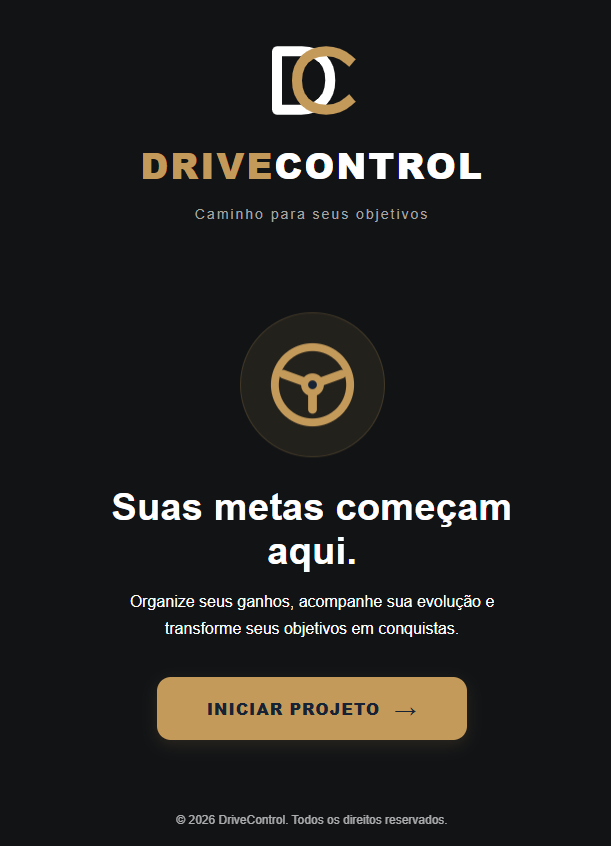
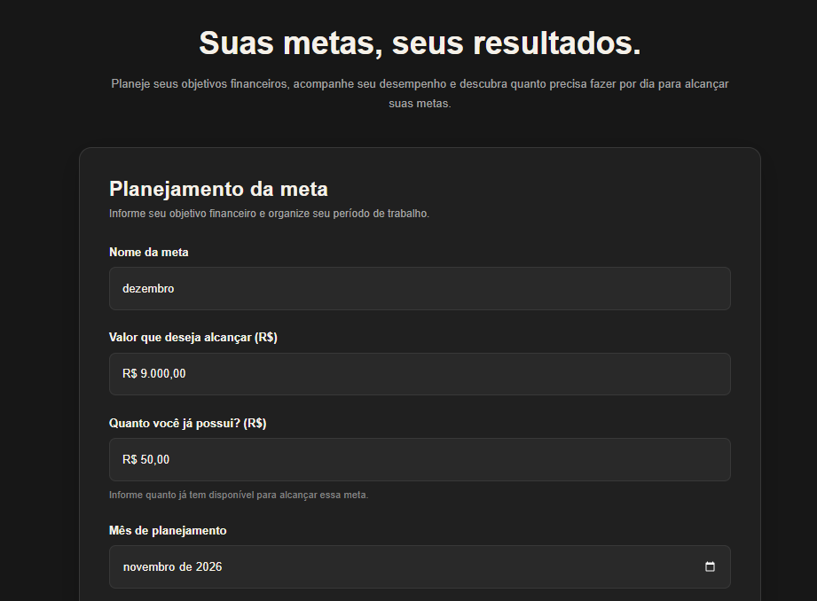
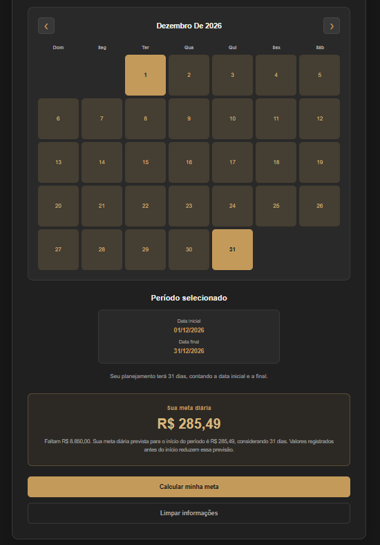
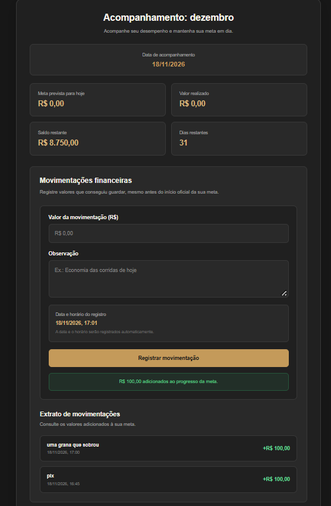
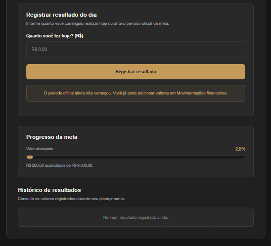

# DriveControl — Planejador de Metas Financeiras

<p align="center">
  <strong>Organize suas metas. Acompanhe seus resultados. Tenha controle da sua evolução financeira.</strong>
</p>

<p align="center">
  Uma aplicação web desenvolvida para auxiliar motoristas no planejamento e acompanhamento de suas metas financeiras.
</p>

---

## Sobre o projeto

O **DriveControl** é uma aplicação web desenvolvida para facilitar o planejamento financeiro, permitindo definir objetivos, acompanhar resultados e controlar movimentações financeiras em um único ambiente.

O sistema foi pensado especialmente para motoristas que desejam organizar sua rotina financeira, estabelecer metas e acompanhar sua evolução ao longo de um período.

## Funcionalidades

- **Planejamento financeiro:** definição de metas e saldo inicial.
- **Período personalizado:** seleção de data inicial e final.
- **Meta diária automática:** cálculo do valor necessário por dia para alcançar o objetivo.
- **Calendário:** visualização e seleção do período planejado.
- **Acompanhamento diário:** registro dos resultados realizados.
- **Movimentações financeiras:** registro de entradas e saídas com observações.
- **Histórico financeiro:** consulta das movimentações registradas.
- **Gráfico de progresso:** acompanhamento visual da evolução percentual da meta.
- **Atualização automática:** recálculo dos valores conforme os registros realizados.
- **Persistência de dados:** armazenamento das informações no navegador por meio do LocalStorage.

## Demonstração do sistema

### Tela inicial



### Cadastro e configuração



### Calendário e seleção de período



### Acompanhamento financeiro



### Gráfico de progresso da meta



## Tecnologias utilizadas

| Tecnologia | Utilização |
|---|---|
| HTML5 | Estrutura da aplicação |
| CSS3 | Estilização e responsividade |
| JavaScript | Lógica e funcionalidades |
| LocalStorage | Armazenamento de dados no navegador |
| Git | Controle de versão |
| GitHub | Hospedagem do repositório |

## Estrutura do projeto

```text
DriveControl/
│
├── css/
│   ├── metas.css
│   └── style.css
│
├── js/
│   └── metas.js
│
├── screenshots/
│   ├── acompanhamento.png
│   ├── cadastro.png
│   ├── calendario.png
│   ├── grafico-meta.png
│   └── tela-inicial.png
│
├── index.html
├── metas.html
└── README.md
```

## Exemplo de lógica JavaScript

O progresso percentual da meta pode ser calculado a partir do valor acumulado em relação ao objetivo financeiro:

```javascript
const metaFinanceira = 10000;
const valorAcumulado = 2500;

const percentual = (valorAcumulado / metaFinanceira) * 100;

console.log(`Progresso da meta: ${percentual}%`);
```

Esse exemplo demonstra o conceito matemático utilizado para representar a evolução percentual de uma meta financeira.

## Como executar o projeto

1. Clone este repositório:

```bash
git clone https://github.com/gabrieljdsantos/Drive-control-planner.git
```

2. Acesse a pasta do projeto:

```bash
cd Drive-control-planner
```

3. Abra a pasta no Visual Studio Code.

4. Execute o arquivo `index.html` no navegador.

## Desenvolvedor

**Gabriel Santos**

Estudante de Análise e Desenvolvimento de Sistemas (ADS) e desenvolvedor em formação, com interesse em desenvolvimento web e criação de soluções práticas por meio da tecnologia.

## Conecte-se comigo

<p align="center">
  <a href="https://github.com/gabrieljdsantos">
    
  </a>
  <a href="https://www.instagram.com/gabriel_jdsantoss/">
    
  </a>
  <a href="https://www.linkedin.com/in/gabrieljdsantos/">
    
  </a>
  <a href="https://dev.to/gabriel_jdsantos">
    
  </a>
  <a href="https://wa.me/5511991273616">
    
  </a>
</p>

---

<p align="center">
  Desenvolvido por <strong>Gabriel Santos</strong>.
</p>

<p align="center">
  Projeto desenvolvido para aprendizado e aplicação prática de tecnologias de desenvolvimento web.
</p>